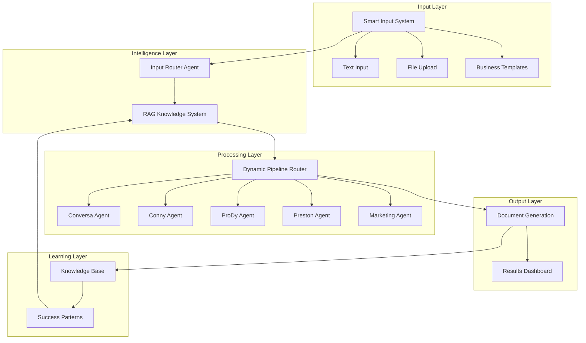

# 🚀 LlamaIndex Smart Business Input Router - System Overview

The router is an internal proposal-drafting prototype. The diagrams below describe the intended architecture, including retrieval from past proposals and feedback from completed engagements.

## 🎯 Design goals

- Route transcripts, strategy notes and requirements to the relevant drafting steps.
- Retrieve similar proposals and make their source material available to the reviewer.
- Use recorded outcomes to assess whether a suggested approach transfers to another proposal.

The demo uses fictional inputs and can run a simulated pipeline. Its [four synthetic checks](../PLATFORM_VALIDATION_COMPLETE.md) do not measure effort saved, proposal quality or business outcomes.

## 🎯 System Architecture Overview



## 🎯 Core System Components

### **1. 💭 Smart Input System** 
The input interface supports the text and file formats below.

#### **Capabilities:**
- **Example inputs**: Transcripts, strategic notes, competitive intel, requirements, thoughts
- **Intelligent format detection**: Auto-detects content type and structure
- **Business template library**: Pre-built templates for common business scenarios
- **Real-time analysis preview**: Shows how system interprets content

#### **Technical Implementation:**
```python
# Multi-format input handling
def render_smart_input_section():
    # Text input with markdown support
    # File upload (TXT, MD, DOCX, PDF)
    # Business templates (discovery calls, strategic planning, competitive analysis)
    # Real-time content analysis and preview
```

#### **Business Templates:**
- **Customer Discovery Call**: Structured template for sales conversations
- **Strategic Initiative**: Framework for internal strategic planning
- **Competitive Analysis**: Template for competitive intelligence gathering

### **2. 🤖 Input Router Agent**
**Intelligent content analysis that creates comprehensive routing plans**

#### **Analysis Capabilities:**
- **Content classification**: 6 content types (transcript, strategic, competitive, requirements, feedback, general)
- **Industry identification**: Technology, manufacturing, healthcare, finance, retail, education, real estate
- **Stakeholder analysis**: Decision makers, influencers, end users, procurement
- **Solution type detection**: Automation, analytics, integration, transformation, optimization, security
- **Urgency assessment**: Low, medium, high, critical priority levels
- **Budget/timeline extraction**: Financial and temporal constraints identification

#### **Dynamic Routing Output:**
```json
{
  "transcript": true/false,
  "content_type": "customer_transcript|strategic_planning|competitive_analysis|...",
  "industry": "technology|manufacturing|healthcare|...",
  "solution_types": ["automation", "analytics", "integration"],
  "urgency_level": "low|medium|high|critical",
  "stakeholders": {
    "decision_makers": ["VP Engineering", "CTO"],
    "influencers": ["Technical Lead", "Security Manager"]
  },
  "agent_routing": {
    "conversa": {"execute": true, "priority": 1, "special_instructions": "..."},
    "conny": {"execute": true, "priority": 2, "special_instructions": "..."}
  },
  "rag_search_terms": ["digital transformation", "process automation"]
}
```

### **3. 📚 RAG Knowledge System**
The retrieval design uses stored proposals, metadata and outcomes when available.

#### **Knowledge Base Components:**
- **Proposal repository**: Historical proposals with metadata and outcomes
- **Success pattern analysis**: Winning approaches and strategies
- **Competitive intelligence**: Past victories against specific competitors  
- **Industry expertise**: Sector-specific templates and approaches
- **Stakeholder insights**: Decision maker preferences and communication styles

#### **Similarity Matching:**
- **Contextual search**: Industry + solution type + stakeholder analysis
- **Relevance scoring**: Rank suggestions by similarity. Reviewer judgments would be needed to assess relevance.
- **Success bias**: Prioritizes won deals and successful outcomes
- **Outcome feedback**: Index additional proposals and evaluate subsequent suggestions

#### **Context Integration:**
```python
# Fictional retrieval example. The relevance score and deal outcome are sample values.
proposal_context = {
    "similar_proposals": [
        {
            "customer": "Industrial Corp",
            "relevance": 0.87,
            "summary": "Manufacturing automation with change management",
            "outcome": "won",
            "key_insights": ["Job enhancement focus", "Union engagement"]
        }
    ],
    "reusable_content": [
        "Change management framework for manufacturing",
        "ROI calculation templates",
        "Stakeholder communication plans"
    ]
}
```

### **4. 🔀 Dynamic Pipeline Router**
**Context-aware workflow orchestration that optimizes agent execution**

#### **Smart Agent Selection:**
- **Conditional execution**: Skip unnecessary agents based on content analysis
- **Priority ordering**: Execute agents in optimal sequence
- **Context enhancement**: Provide relevant business intelligence to each agent
- **Design aim**: Skip unnecessary steps and assess the effects on duration and output quality

#### **Agent Routing Logic:**
```python
# Example routing decisions
if routing_info["transcript"]:
    execute_conversa = True  # Transcript analysis needed
else:
    execute_conversa = False  # Skip for strategic content

if "optimization" in routing_info["solution_types"]:
    execute_preston = True  # Process optimization focus
else:
    execute_preston = False  # Skip optimization agent

# Always execute core business agents
execute_conny = True      # Business consulting
execute_prody = True      # Document generation  
execute_marketing = True  # Sales materials
```

### **5. ⚡ Specialized AI Agents**
**Expert agents with contextual intelligence and domain expertise**

#### **🔍 Conversa Agent** (Conditional Execution)
- **Purpose**: Transcript analysis and requirements extraction
- **Execution**: Only for actual transcripts (conversation content)
- **Enhanced with**: Past transcript patterns, industry-specific extraction templates
- **Output**: Structured requirements, stakeholder analysis, pain point identification

#### **🧠 Conny Agent** (Always Executes)  
- **Purpose**: Business consulting and strategic recommendations
- **Execution**: Core agent for all business content
- **Enhanced with**: Industry expertise, competitive intelligence, success patterns
- **Output**: Solution architecture, implementation approach, competitive positioning

#### **📄 ProDy Agent** (Always Executes)
- **Purpose**: Document generation with industry-specific templates
- **Execution**: Creates all proposal documents
- **Enhanced with**: Reusable content, successful document patterns, industry templates
- **Output**: Problem overview, solution approach, investment proposal, implementation plan

#### **⚡ Preston Agent** (Conditional Execution)
- **Purpose**: Process optimization and efficiency analysis  
- **Execution**: Only for optimization-focused content
- **Enhanced with**: Process improvement patterns, efficiency benchmarks
- **Output**: Process analysis, optimization recommendations, efficiency metrics

#### **🎨 Marketing Agent** (Always Executes)
- **Purpose**: Customer-facing sales deck creation
- **Execution**: Creates sales presentations for all proposals
- **Enhanced with**: Competitive messaging, successful pitch patterns, stakeholder preferences
- **Output**: Executive presentation, value proposition, competitive differentiation

## 🎯 Data Flow Architecture

### **Input Processing Flow:**
```
Business Input → Content Analysis → Industry/Solution Classification → 
Stakeholder Identification → RAG Search → Agent Routing → Document Generation
```

### **Knowledge Integration Flow:**
```
New Proposal → Success Analysis → Pattern Extraction → Knowledge Base Update → 
Future Proposal Enhancement
```

### **Continuous Learning Flow:**
```
Proposal Outcome → Success Factor Analysis → Pattern Database Update → 
Enhanced Future Recommendations
```

## 🎯 Evaluating the design

The original design aimed to shorten proposal drafting and help staff reuse past work. Testing those aims requires comparable proposal briefs and a shared endpoint, such as a reviewer accepting a draft. Record time spent on research, generation, review and corrections for each workflow. Compare errors and omissions against the brief and record any operating costs.

The prototype supplies no measured baseline, labor saving or quality improvement. The fictional retrieval example above illustrates the data format only.

## 🎯 Technical Stack

### **Core Technologies:**
- **Frontend**: Streamlit (main app) + React (admin dashboard)
- **AI Framework**: LlamaIndex 0.11+ with AgentWorkflow
- **LLM Provider**: OpenRouter (openai/gpt-oss-120b unified configuration)
- **Vector Database**: Jina AI embeddings + reranking
- **Backend**: FastAPI with WebSocket streaming
- **Database**: PostgreSQL for workflow tracking
- **Knowledge Base**: File-based with JSON indexing

### **Model Configuration:**
- **Unified LLM**: openai/gpt-oss-120b is the model named in this design
- **Configuration**: The design uses one model across agents
- **Performance**: Processing time is an evaluation target

## 🎯 Deployment Architecture

### **Development Environment:**
```bash
streamlit run streamlit_app/main.py  # Main application
cd fe/ && npm run dev              # Admin dashboard  
cd be/ && python src/main.py      # Backend API (when needed)
```

### **Production Considerations:**
- **Horizontal scaling**: Multiple Streamlit instances with load balancer
- **Knowledge base**: Move to vector database (Pinecone, Weaviate)
- **Model optimization**: Dedicated models per agent for performance
- **Security**: API key management, user authentication, data encryption
- **Monitoring**: Usage analytics, performance metrics, success tracking

## 🎯 Proposed metrics

The thresholds below are historical design targets. This document records no benchmark runs or outcomes against them.

### **Operational targets**
- **Processing time**: Target <3 minutes per proposal
- **Quality score**: Target >95% relevance through user feedback
- **Agent routing**: Target >90% agreement with reviewed routing decisions
- **Retrieval**: Proposed similarity threshold above 85%. Assess relevance separately with reviewers.

### **Business Impact Metrics:**
- **Cycle-time reduction**: Target 70%+ improvement
- **Proposal win rate**: Record outcomes and comparison conditions
- **User adoption**: Usage frequency and engagement metrics
- **Knowledge growth**: Proposal database growth and pattern development

### **ROI Tracking:**
- **Time savings**: Hours saved per proposal
- **Cost reduction**: Consultant time savings quantification
- **Quality improvement**: Proposal effectiveness metrics
- **Knowledge value**: Reuse and pattern application tracking
